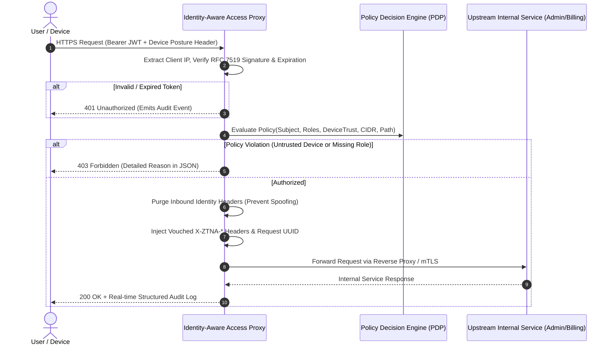

# Zero Trust Identity-Aware Access Proxy (ZTNA Gateway)

[](https://github.com/nauman/identity-access-proxy/actions)
[](https://go.dev/)
[](https://csrc.nist.gov/publications/detail/sp/800-207/final)
[](LICENSE)

A high-performance, identity-aware reverse proxy and Zero Trust Network Access (ZTNA) policy enforcement engine built from the ground up in Go using the standard library.

Designed around **NIST SP 800-207** and **Google BeyondCorp** principles, it replaces legacy perimeter VPNs with per-request cryptographic authentication, device posture scoring, context-aware policy decisions, and sanitized identity propagation.

---

## Architecture Overview



---

## Key Engineering Decisions & Trade-Offs

| Decision | Approach Chosen | Rationale & Trade-Off |
| :--- | :--- | :--- |
| **Framework vs. Stdlib** | Go standard library (`net/http` + `httputil.ReverseProxy`) | Eliminates third-party dependency vulnerabilities (CVEs), minimizes binary size (~15MB Docker image), and maximizes raw networking performance with zero allocations in the hot path. |
| **Constant-Time Verification** | `crypto/subtle.ConstantTimeCompare` for HMAC | Defeats side-channel timing attacks where an attacker measures string comparison microsecond differences to infer secret keys. |
| **Default Posture** | Explicit **Default Deny** | Unmapped paths or unauthenticated requests are dropped by default, strictly adhering to Zero Trust "never trust, always verify". |
| **Identity Propagation** | Header Sanitization & Injection (`X-ZTNA-*`) | Upstream microservices do not need to parse or maintain JWT cryptographic state; the proxy validates credentials once at the edge and forwards sanitized, signed identity headers. |

---

## Security Threat Scenarios & Mitigations

The test suite in [`test/failure_scenarios_test.go`](test/failure_scenarios_test.go) validates automated resilience against adversarial attempts:

1. **Header Injection / Spoofing**: An attacker sending `X-ZTNA-Subject: root` directly has their header stripped and replaced by the validated token subject.
2. **Signature Tampering**: Tokens altered in transit fail HMAC/RSA validation with `401 Unauthorized`.
3. **Expired Credential Replay**: Expired tokens fail with `ErrTokenExpired` taking clock skew leeway into account.
4. **Untrusted Device / BYOD Access**: Valid credentials presented from unmanaged or unencrypted machines are blocked by policy with `403 Forbidden`.

---

## Project Structure

```
.
├── cmd/
│   ├── proxy/                 # Gateway main entry point
│   └── token-dispenser/       # CLI utility to mint test tokens
├── internal/
│   ├── auth/                  # RFC 7519 JWT engine & context helpers
│   ├── audit/                 # Structured CloudEvents audit logger
│   ├── config/                # JSON config parser & env overrides
│   ├── policy/                # Policy Decision Point (PDP) engine
│   └── proxy/                 # Reverse proxy & mTLS transport
├── test/
│   └── failure_scenarios_test.go # Chaos & adversarial test suite
├── examples/
│   ├── config.json            # Local development configuration
│   ├── docker-config.json     # Docker Compose routing configuration
│   └── upstream/              # Mock internal microservices
├── docs/
│   ├── architecture.md        # Technical architecture specification
│   └── threat_model.md        # Threat model & security controls
├── Dockerfile                 # Multi-stage minimal container build
├── docker-compose.yml         # One-command orchestration
└── Makefile                   # Build, test, and run automation
```

---

## Quickstart (Run in 2 Minutes)

### Option 1: Docker Compose (Recommended)

Boot the entire stack (Access Proxy + Admin Service + Billing Service):

```bash
docker compose up --build
```

The gateway listens on `http://localhost:8080`.

---

### Option 2: Local Development with `make`

1. **Run tests**:
   ```bash
   make test
   ```

2. **Start Mock Upstream Services**:
   ```bash
   # Terminal 1: Admin service on port 8081
   make run-upstream-admin

   # Terminal 2: Billing service on port 8082
   make run-upstream-billing
   ```

3. **Start the Access Proxy**:
   ```bash
   # Terminal 3: Proxy on port 8080
   make run-proxy
   ```

---

## Testing Scenarios with the Token Dispenser

We provide a built-in CLI tool to mint valid, role-scoped tokens for testing:

### 1. Mint an Admin Token
```bash
go run cmd/token-dispenser/main.go -sub alice -roles admin -trust high
```

### 2. Test Compliant Admin Access (200 OK)
```bash
curl -i -H "Authorization: Bearer <TOKEN>" \
     -H 'X-Device-Posture: {"is_managed":true,"disk_encrypted":true,"trust_score":95}' \
     http://localhost:8080/api/v1/admin/dashboard
```

### 3. Test Device Posture Violation (403 Forbidden)
Presenting the same admin token from an unmanaged, personal computer:
```bash
curl -i -H "Authorization: Bearer <TOKEN>" \
     -H 'X-Device-Posture: {"is_managed":false,"disk_encrypted":false,"trust_score":30}' \
     http://localhost:8080/api/v1/admin/dashboard
```
*Result:* Returns `403 Forbidden` with reason: `"device posture failed: endpoint must be an organization-managed device"`.

### 4. Test Missing / Invalid Token (401 / 403)
```bash
curl -i http://localhost:8080/api/v1/admin/dashboard
```

---

## Structured Audit Logging Example

Every inbound request emits real-time JSON audit telemetry:

```json
{
  "event_id": "a9d7f8c14e0b321a",
  "timestamp": "2026-11-18T17:45:00.123456Z",
  "client_ip": "192.168.1.10",
  "subject": "alice",
  "roles": ["admin"],
  "method": "GET",
  "path": "/api/v1/admin/dashboard",
  "device_id": "dev-macbook-pro-01",
  "device_trust": "high",
  "allowed": true,
  "rule_id": "rule-admin-superpowers",
  "reason": "authorized by rule rule-admin-superpowers",
  "status_code": 200,
  "duration_micros": 1420
}
```

---

## License
MIT License. Open for educational and production reference.
